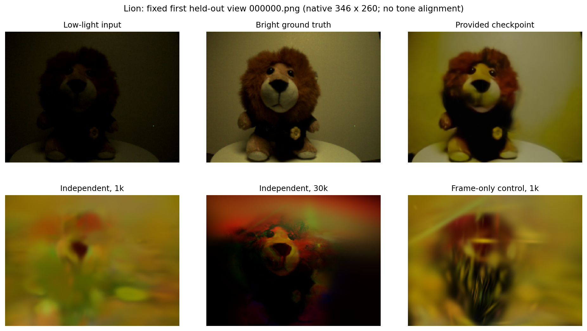
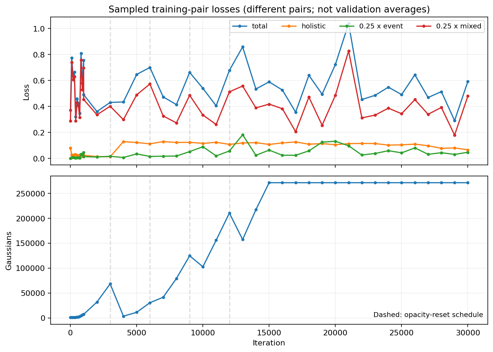

# Colab T4 实测记录（2026-10-27）

这是独立实现的运行记录，不是作者论文结果的确认。已连接用户现有 T4 会话，未另行申请 GPU 虚拟机。原始数据及公开检查点保留不变，所有实验产物写入 `/content/dark-evgs-validation-001/`。

## 环境与验证

- GPU：Tesla T4，15GB 显存；主机内存约 12GB、2 CPU。
- 独立环境：Python 3.12.15、PyTorch 2.5.1+cu121、Torchvision 0.20.1+cu121、LPIPS 0.1.4。
- 本地编译器：NVCC 12.6.85，GCC 13.3；驱动 580.82.07。
- 固定上游光栅化版本：`59f5f77e3ddbac3ed9db93ec2cfe99ed6c5d121d`，GLM 子模块保持其固定提交。
- 构建只增加 `<cstdint>` 预包含选项，未修改上游依赖源码；编译并行度 2、GPU 架构 7.5。CUDA 编译器与 PyTorch wheel 的次版本差异在本次 T4 上通过实际验证。
- 完整测试：**31 passed in 43.69s**，包括原生 CUDA 前反向、投影、增密、Adam 状态恢复及 PLY 读写。
- 合成 CUDA 端到端：先验训练 → 伪图 → 高斯训练 → 续训 → 留出视图渲染 → PSNR/SSIM，已通过。CPU 参考端仍精确对比；GPU 恢复状态精确对比，独立运行按明确的渲染误差阈值比较，不宣称逐参数确定性。

硬件、依赖版本及实际训练/推理核心文件 SHA256 见 [hardware.json](colab/hardware.json)；合成测试细节见 [gpu_smoke.json](colab/gpu_smoke.json)。核心训练/推理代码来自 `e1722ae`，验证期间新增了 Colab 安装器、CUDA 测试和合成检查的 GPU 模式。

## 真实数据实验协议

原作者用于 CTCM 的 500 组辅助样本、微调权重和完整架构未公开。因此本次采用可运行且场景隔离的替代协议：

| 用途 | 场景 | 样本 |
|---|---|---:|
| 独立紧凑先验训练 | Baseball | 100 对相邻暗/亮图与事件 |
| 先验验证 | Panda | 119 对相邻暗/亮图与事件 |
| 高斯场景训练 | Lion | 144 张训练视图及其事件 |
| 最终目标评估 | Lion | 36 张留出视图 |

辅助场景与目标 Lion 不重叠。Lion 明亮图仅在训练完成后的指标计算中读取，不用于先验、伪图生成或高斯训练。先验从头训练 5 epoch、宽度 32、5 个事件 bin、训练裁剪 128；不是作者 EvLowLight 初始化后的 CTCM。完整协议摘要见 [protocol.json](colab/protocol.json)、[实际辅助 manifest](colab/auxiliary_manifest.json)，先验损失记录见 [prior_history.jsonl](colab/prior_history.jsonl)。相邻样本共享图像，不等于作者的 500 组无关自然场景样本。

高斯配置：1,000 随机初始点，SH 最高三阶，三项损失权重 `1 / 0.25 / 0.25`，gamma 2.2，epsilon `1e-5`，事件阈值 0.2，时空密度滤波 2,000µs / 半径 1 / 最小邻域事件 2。其余学习率、增密与透明度重置沿用代码默认值；位置学习率会乘以场景尺度。训练原始分辨率为 346×260。未根据 Lion 测试成绩改动超参数。

## Lion 评估

所有数字均为本次 36 张留出视图、原始分辨率、按图名对应、完整 RGB 图像的逐图均值。LPIPS 使用预训练 AlexNet；没有亮度对齐、GT 拟合曝光或其他为提高分数的后处理。

| 模型 | 步数 | PSNR ↑ | SSIM ↑ | LPIPS ↓ |
|---|---:|---:|---:|---:|
| 仓库公开 Lion 检查点 | 30,000 | 21.2847 | 0.7444 | 0.2449 |
| 独立实现，替代先验协议，三项损失 | 1,000 | 15.5431 | 0.5647 | 0.6499 |
| 独立实现，替代先验协议，三项损失 | 30,000 | **14.1187** | **0.3718** | **0.6426** |
| 诊断对照：仅帧级损失，同一先验和数据 | 1,000 | 17.5187 | 0.6147 | 0.5713 |

公开检查点的原始训练划分未知；它在本次留出图上有结果，不证明这些图对该公开模型从未见过。此行用于验证文件加载及 GPU 推理，不能当作与新训练结果严格可比的重新训练基线。

已按同一配置完成 **30,000 步**。初始 1,000 步约 **30.19 秒**，结束时 7,133 个高斯；后续 29,000 步约 **2,060.88 秒**。高斯训练进程合计约 **34.85 分钟**，最终 **271,116 个高斯**。时间含启动和数据加载，期间存在其他验证工作，不是规范吞吐率基准。最终点云所有字段均有限，生成 36 张非全黑渲染图。

**质量验证失败：增加到 30,000 步后，PSNR 和 SSIM 低于 1,000 步结果，存在明显颜色与结构退化。这版独立实现未复现论文效果。** 为诊断问题，另做了相同数据、先验、初始化种子和 1,000 步预算的帧级对照，仅将 `--lambda-event 0 --lambda-mix 0`，得到更高的 PSNR/SSIM。当前事件／混合监督组合没有带来预期收益；需进一步核查事件与图像标定、阈值、先验时序一致性和对数损失的相对尺度。该对照不能单独确定是哪一项引起问题，也不能当作完整 Dark-EvGS 的成绩。

本次结果支持“工程链路可以执行”，不支持“模型质量已成功复现”。保留失败结果及对照，不将最好的一次检查点替代最终成绩。主实验权重始终为 `1 / 0.25 / 0.25`，测试 GT 不参与优化或曝光拟合；帧级对照是退化发生后明确标记的诊断实验，不作为模型选择后的最终论文成绩。



上图固定选取测试清单第一张 `000000.png`，不是按成绩选图。图片没有色调或亮度对齐。



曲线对应日志中的不同训练图对，不是同一验证集的平均误差；虚线表示透明度重置计划，不能仅据曲线波动断言某次重置是退化的唯一原因。

逐图数据：[公开检查点](colab/metrics_author_lion.json)、[三项损失 1,000 步](colab/metrics_lion_1000.json)、[三项损失 30,000 步](colab/metrics_lion_30000.json)、[仅帧级 1,000 步](colab/metrics_holistic_1000.json)。另附 [完整运行配置](colab/run_config.json)、[精确训练/测试清单](colab/lion_split.json)、[训练日志](colab/lion_train_log.jsonl)、[时间记录](colab/timings.json)及[模型完整性检查](colab/model_health.json)。

## 模型与日志保存位置

已导出到用户已挂载的 Google Drive 新目录：

```text
MyDrive/Dark-EvGS-results/2026-10-27-colab-run001/
  lion/point_cloud/iteration_30000/point_cloud.ply
  lion/checkpoints/latest.pt
  lion/run_config.json
  lion/train_log.jsonl
  prior/last.pt
  pseudo-lion/
  author-lion/metrics.json
  lion-1000/metrics.json
  lion-30000/metrics.json
  holistic-control/metrics.json
  files.json
```

核心实验产物 315 个文件、约 290MB，另附清单、说明及报告。最终点云、场景训练检查点和先验检查点已从 Drive 读回并通过 SHA256 校验。`files.json` 保存实验文件校验值；没有复制 OAuth、Colab 连接令牌或 SSH 私钥。导出摘要见 [export.json](colab/export.json)。

当前 Colab 的工作目录 `/content/dark-evgs-validation-001/` 仍保留全部原始实验产物。新会话要继续使用原检查点时，请将源码恢复到 `/content/dark-evgs-reproduction`；严格续训路径检查还要求将 `lion/` 和 `pseudo-lion/` 恢复到 `/content/dark-evgs-validation-001/`。最终 PLY 可用于独立推理，不要求重新训练。

## 怎样重新运行

在 GPU Colab 中克隆仓库后：

```bash
DARK_EVGS_LPIPS=1 bash scripts/setup_colab.sh
/content/.venvs/dark-evgs/bin/python -m pytest -q tests
/content/.venvs/dark-evgs/bin/python scripts/smoke_reproduction.py \
  --workdir /content/new-smoke --device cuda --backend cuda
```

本次替代协议可按以下命令重建。`run_dir` 必须选一个新目录：

```bash
py=/content/.venvs/dark-evgs/bin/python
run_dir=/content/dark-evgs-repeat001
"$py" scripts/prepare_auxiliary.py --output "$run_dir/auxiliary"
"$py" train_prior.py --manifest "$run_dir/auxiliary/manifest.json" \
  --output "$run_dir/prior" --epochs 5 --device cuda --event-bins 5 --width 32
"$py" prepare_pseudo.py --source data/lion --output "$run_dir/pseudo-lion" \
  --checkpoint "$run_dir/prior/last.pt" --device cuda --holdout 5 \
  --timestamp-scale 1e-6 --event-timestamp-scale 1e-6
"$py" train.py -s data/lion -m "$run_dir/lion" --pseudo-dir "$run_dir/pseudo-lion" \
  --iterations 30000 --device cuda --backend cuda --num-points 1000 --holdout 5 \
  --timestamp-scale 1e-6 --event-timestamp-scale 1e-6 --event-contrast .2 \
  --event-filter density --filter-window-us 2000 --filter-radius 1 --filter-min-neighbors 2
"$py" infer.py -m "$run_dir/lion" --split test --device cuda --backend cuda \
  --output "$run_dir/test/renders"
"$py" evaluate.py --renders "$run_dir/test/renders" \
  --ground-truth data/lion/gt_bright_frames --device cuda --lpips
```

`prepare_auxiliary.py` 已在本次真实数据上复跑，输出相同的 100/119 对样本；两个划分首尾样本的体素与实际训练输入逐元素一致。更换辅助数据时请参照 [复现指南](REPRODUCTION.md)。不要覆盖公开模型。

## 结果的边界

目前可以确认安装、CUDA 编译、真实前反向、训练、保存/恢复、公开模型推理和指标计算能够运行。**这些证据不等于严格复现论文。** 独立先验、辅助数据、划分索引、滤波参数和初始化范围均有已披露的差异，且初步分数与论文 Lion 的 31.22dB 仍有明显差距。不能用合成小样本通过或成功完成训练来替代论文级质量验证。
